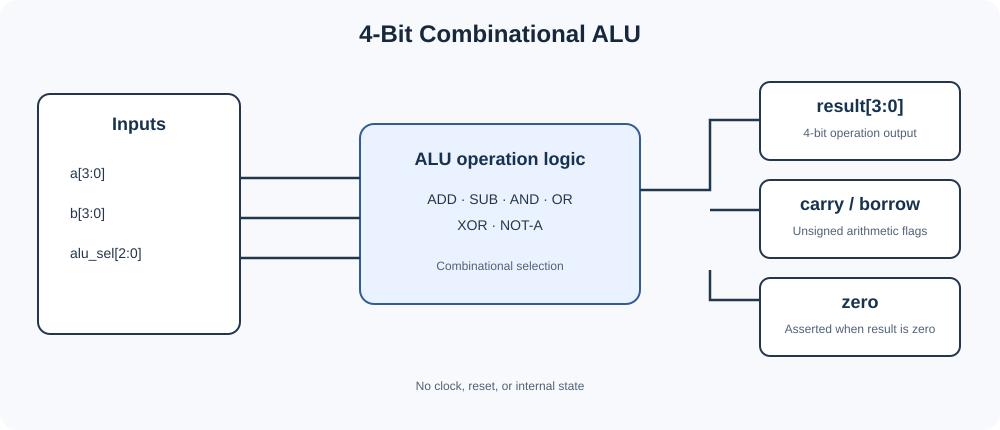

# 4-Bit Arithmetic Logic Unit

[](https://github.com/saiv9/four-bit-ALU-verilog/actions/workflows/simulation.yml)

A 4-bit combinational ALU written in Verilog-2001. It supports six operations and provides carry, borrow, and zero status outputs. A self-checking testbench exhaustively checks every pair of 4-bit operands for the supported operations.

## Operations

| `alu_sel` | Operation | Result | Status |
|---|---|---|---|
| `000` | Addition | `a + b` | `carry_out` is the fifth result bit |
| `001` | Subtraction | `a - b` | `borrow_out` is high when `a < b` |
| `010` | AND | `a & b` | Carry and borrow are cleared |
| `011` | OR | `a \| b` | Carry and borrow are cleared |
| `100` | XOR | `a ^ b` | Carry and borrow are cleared |
| `101` | NOT-A | `~a` | Carry and borrow are cleared |
| `110`, `111` | Reserved | `0000` | Carry and borrow are cleared |

The `zero` output is high whenever the four-bit result is `0000`, including for a reserved operation code.

## Architecture



The block is purely combinational. It has no clock, reset, or internal state. Default assignments are made before the operation selection to avoid unintended latch inference.

## Interface

| Signal | Direction | Description |
|---|---|---|
| `a[3:0]`, `b[3:0]` | Input | 4-bit operands |
| `alu_sel[2:0]` | Input | Operation selector |
| `result[3:0]` | Output | 4-bit operation result |
| `carry_out` | Output | Unsigned addition carry |
| `borrow_out` | Output | Unsigned subtraction borrow |
| `zero` | Output | High when `result == 0` |

## Run the simulation

Install Icarus Verilog and GNU Make. From the repository root, run:

```bash
make sim
```

Or compile directly:

```bash
iverilog -g2005 -o alu_sim rtl/alu_4bit.v tb/tb_alu_4bit.v
vvp alu_sim
```

The testbench checks all 256 operand pairs for each of the six supported operations, then checks both reserved operation codes. This gives 1,538 result and flag checks. A successful local run prints:

```text
PASS: all ALU tests completed successfully.
```

GitHub Actions runs the same testbench on pushes and pull requests.

## Optional synthesis

With Yosys installed, run:

```bash
make synth
```

This reports a synthesis statistics pass. It is not a placement, routing, or timing-closure result.

## Scope

This is a small unsigned 4-bit educational datapath. It does not implement signed arithmetic, overflow detection, shifts, multiplication, or a registered pipeline. No physical FPGA testing is claimed.

## License

MIT. See [LICENSE](LICENSE).
